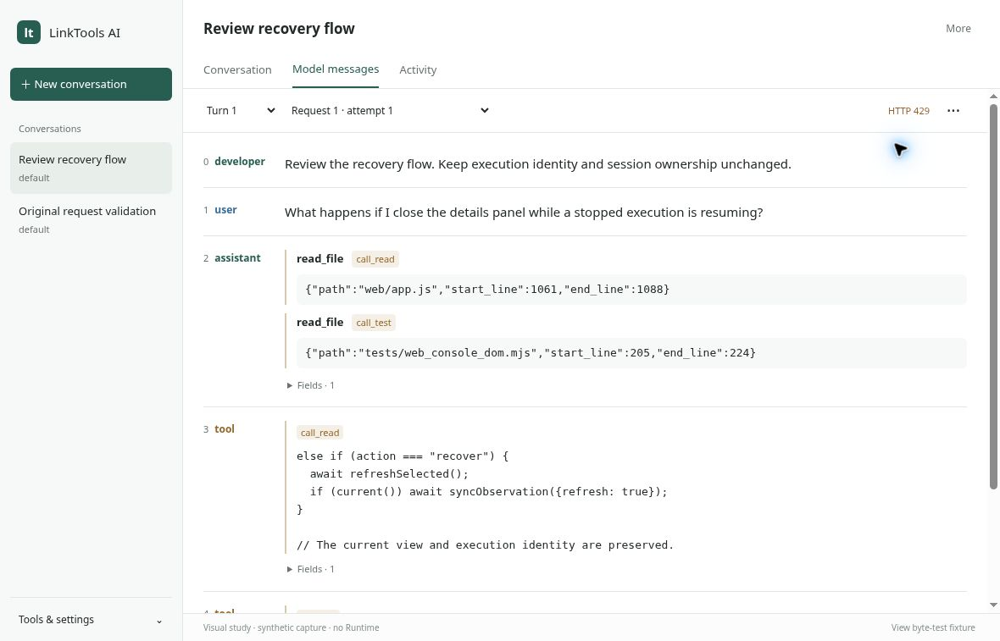
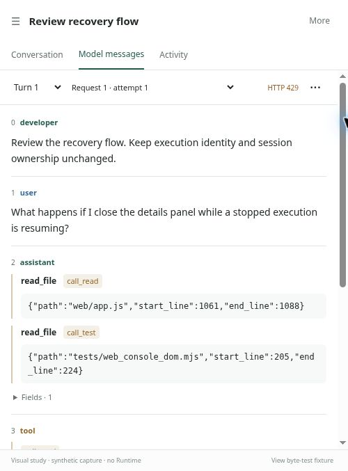

# Local Web console

The console adds a local browser interface to the same Runtime used by the AI
commands. The CLI now contains only `ai-run`, `ai-acp`, and `ai-web`; the five
inspection commands are consolidated here. Runtime still owns the execution
store, conversation history, scheduling, recovery, and metrics.

## Start

```bash
python manage.py install --editable 'linktools-ai[web]'
ai-web --project /path/to/project --model your-model
# Equivalent entry point:
python -m linktools ai web --project /path/to/project --model your-model
```

The execution stack requires `pydantic-ai-slim>=2.53.0,<3.0.0`. After updating
the checkout, rerun the install command in the same virtual environment as
`ai-web`; an existing editable install does not refresh dependency metadata
until it is installed again. `--help` only exercises lightweight CLI discovery.

Open `http://127.0.0.1:8765`. `--port` selects another local port, and `--open`
opens the URL in your browser. The existing `--base-url`, `--api-key`,
and `--memory` arguments have the same meaning as `ai-run`; prefer environment
configuration for credentials rather than shell history. The console does not
persist or edit model credentials.

Connection configuration uses the shared CLI configuration and its `LINKTOOLS_`
environment prefix. Model file-input policy uses the existing workspace file
`.linktools/config.yaml`, shared by `ai-run`, `ai-acp`, and `ai-web`:

```yaml
model: your-model
input_types:
  - image
  - document
  - mime:audio/*
  - mime:application/pdf
```

Omitting `input_types` means an empty attachment allowlist. The names `image`,
`audio`, `document`, and `video` expand to the corresponding SDK Literal sets.
Use `mime:` for explicit MIME values or `type/*` families; bare MIME strings and
`text` are not categories. Plain prompt text is unaffected.

The console's "Captured input MIME types" panel shows the expanded, normalized
`input_mime_types` list from the captured contract. It does not show the original
authoring tokens. These stored MIME permissions are not re-expanded at restore.
A match permits an input but does not verify provider support; SDK encoding and
resource limits still apply. Without a configured model, settings report that
no model is configured.

The old `--vision` flag is removed. Remove `OPENAI_VISION` and
`LINKTOOLS_OPENAI_VISION` from environment/persisted configuration and workspace
`vision` settings; any remaining value, even false or empty, produces a migration
error instead of an implicit fallback. Use `input_types` explicitly.

```bash
ai-web --project /path/to/project --read-only
```

Read-only mode opens `RuntimeHistory`, never an execution `Runtime`, and does not
invoke recovery. It also works without a model configuration. An unconfigured
model automatically selects this mode. Missing history and metrics stores are
shown as empty/unavailable, without provisioning them through a history read.

### Finding details and controls

The default **Conversation** view is the everyday workspace: conversation list,
Markdown messages and composer. New conversation asks for an Agent first; title
and working directory are under an optional disclosure. Successful turns do not
repeat technical status badges or expanded diagnostics. Failures, incomplete
responses, occupied sessions and unconfirmed cancellation remain visible.

The primary views are **Conversation**, **Model messages** and **Activity**.
Model messages opens the selected turn's actual captured input directly: indexed
role and content rows follow the native `messages` array order. A single request
and attempt selector switches among loaded captures, without nested request
cards. Turn and request selectors share one light toolbar; compact turn labels keep
their full time, status and execution identity in the control's hover/accessibility
description and the Run details picker. Older turns remain accessible and distinct
from the active conversation owner. **Request tools (···)** groups **View raw**,
**Download bytes** and **Inspect request** in one menu. The request details keep model,
purpose, timing, usage, API identity and the client-capture boundary out of the
main reading path. HTTP failures remain visible beside the selectors.

Interface titles name their content, buttons name their action, and routine status
uses one short message. Repeated technical explanations expand on demand; errors,
read-only limits and recovery confirmations remain explicit. This applies only to
console-authored text: captured messages, source bytes and tool arguments are
never rewritten or summarized.

The body is the primary surface: indexed roles align with unchanged message
content; compact function names and call IDs connect tool calls with their
separate result items visually, without moving or merging either array item.
**Fields** beside an item retains structural annotations and additional original
members. Empty, null, missing, repeated and unknown values stay inspectable;
Fields expansion and keyboard focus survive capture refresh. The observed
response remains separate from input. Repeated input arrays are never interleaved
as new conversation turns. The optional live preview is explicitly a conversation
display, not the original response bytes.

### Visual reference and implementation status

The following approved layout studies use synthetic captured-request-shaped data.
They show the current design direction, not a deployed console or a claim that
these requests reached a provider. The [DeepSeek Harness trajectory reference](https://www.deepseek.com/harness/images/feat-trace-en.webp)
informs alignment and direct role/content reading only; its session event ledger
is not substituted for this console's captured HTTP input.

Desktop: a single selection toolbar, aligned role column, body-first typography,
and contextual details rather than stacked request cards.



At 500 px, roles sit above their contents while the same selection and request
tools remain on one row. Message order and content do not change with width.



The production console implements this visual hierarchy, including the shared
selection toolbar, direct model-message reader, request tools and responsive
role layout. These images remain design studies, not production screenshots or
proof of provider receipt. [PR #167](https://github.com/linktools-toolkit/linktools/pull/167)
records the production-browser acceptance and automated verification for the
implemented assets. The layout introduces no new message protocol, renderer
owner, Runtime behavior or source reconstruction.

### Conversation, activity and diagnostics

**Activity** opens the existing recorded event timeline in the main reading
area. **More → Run details** contains selected-turn diagnostics and actions.
Their turn picker shares the same explicit execution selection. Reading modes
hide the composer; the same active Stop control remains beside the primary views.
Returning to Conversation restores the existing draft and focuses the composer.

Session occupancy comes from the active execution identity. Inspecting an older
turn never redirects active Stop to that turn. **View active execution** returns
to the owner. Details also offers **Stop active conversation** when it is
inspecting a different execution. Opening a diagnostic panel does not stop the
conversation observer. Metrics is a separate page; Executions has its own run
browser. Browser Back/Forward restores the corresponding page.

- **Run details** is centered on the selected turn: compact status, elapsed time and
  request/token usage stay visible, and the default body shows original model
  requests directly. A single **Inspect** selector replaces stacked tab bars.
  **All run metadata** keeps full execution/session fields and detailed usage;
  **Activity & tools** presents recorded events in their original order as a
  compact timeline. Select an event for its locators, usage, original record,
  SDK content drilldown and recorded child execution link. Live tree depth and
  parent execution navigation remain intact; the timeline invents no hierarchy.
  Parent/conversation links remain beside the selected identity. Closing Details
  returns focus without stopping observation or changing the selection.
- **Actions** in Details groups retry with a new prompt, fork and final JSON
  download. Stop remains directly visible for running work, including the actual
  active conversation while an older turn is selected. Failure and recovery
  states remain prominent; **Review recovery** leads directly to the same
  confirmed Resume/End and external-effect controls. **Recovery & stopped work**
  is also available from Inspect and Actions, separately from SDK debugging.
- **Inspect → Advanced SDK debugging** contains **SDK structured records**,
  **SDK text excerpts** and **SDK preparation snapshot**. These are projections,
  not final outbound messages. Instructions is labeled as a separate SDK request
  field rather than another message before a system part; original data and
  projection order are unchanged. Text excerpts contain only user/assistant text
  and omit other parts. Each debug view links to captured original requests
  instead of implying that its display order is the client message order.
- **More** groups run details, conversation rename/fork/close and recovery entry points.
  Running work has a direct **Stop** beside Send. Recovery needs and pending
  cancellation expose **Recovery options**; explicit Resume/End choices remain
  available after confirming the previous executor has stopped. They never
  infer process death or silently take ownership.
- **Options** beside the composer contains planning, thinking, memory scope and
  workspace files and keyboard/lifecycle hints. Ctrl / Cmd Enter sends. Each message's Markdown source
  disclosure preserves original source and its copy action.
- **Tools & settings** contains Executions, Metrics, exact-ID lookup and Runtime
  capabilities. Execution filters, explicit newest-20 scans, list paging and the
  full metric query retain their original behavior. A Conversations button
  returns from other pages. The narrow-screen sidebar closes after navigation
  and has its own close button and Escape support.
- Tool/thinking content and ordinary activity expand on demand. Failure,
  recovery, cancellation, input-required events and observation interruptions
  remain visible. A healthy connection is not a second execution-status badge.

### Shared storage and explicit recovery

The default local SQL Runtime can open alongside another process using the same
namespace, tenant, and storage without resuming its live execution. Writable
and read-only consoles read the same committed history. Independent sessions
can run concurrently; a second execution in the same session is rejected with
`SESSION_BUSY`.

SQL startup does not infer that an unfinished execution is abandoned. A stopped
process can leave `PENDING_START`, `STARTED`, or `CANCELLING` visible. Refresh and
observation never take ownership. After confirming the previous executor has
stopped, use **More → End previous execution and free session** in the conversation
header to cancel the old work and release its session in one action. Standalone
executions label this action **End stopped execution**. The console requires
durable `CANCELLING` state or a successful cancellation receipt for the same
execution before finishing it through Runtime recovery. Unknown external effects
may keep `RECOVERY_REQUIRED` visible even after cancellation is recorded. The
console then verifies a terminal execution and
released session owner. It does not resume model or tool work. Unknown outcomes
are not reported as complete; another explicit attempt reads the current state
before continuing. Resolve unknown external effects in **Recovery** if needed.

To continue the original work instead, **More → Run details → Inspect → Recovery & stopped work → Resume stopped execution**
retains the explicit stopped-executor confirmation and may call models or tools.
**Stop execution** remains available for a running executor. A cancellation
request may remain `CANCELLING` until the owner finishes or the stopped-execution
action completes its cancellation. Its pending notice updates after terminal and
session-owner readback, without replacing an unrelated error. Cancellation is
shown as a normal turn outcome. Recovery uses the existing Runtime idempotency
key so a repeated request cannot start another recovery attempt; ending and
resuming work keep separate request identities.

Runtime owns producer fencing, terminal handoff, and local staging release.
The console does not introduce a private lock, heartbeat, background result
consumer, or alternative recovery implementation. See the
[Runtime history guide](runtime-history.md) for storage-specific recovery and
publication guarantees.

## Command consolidation and coverage

`ai-history`, `ai-session`, `ai-status`, `ai-trace`, and `ai-metrics`, including
their `lt ai` / `python -m linktools ai` forms, are intentionally removed. There
are no compatibility aliases. Start `ai-web --read-only` to inspect an existing
workspace, then choose Session or Execution in **Open exact ID** to open a known
identity. `ai-run` and `ai-acp` remain available for terminal execution and ACP
stdio clients. The console uses the same public Runtime domains.

The former viewers had no filter or export flags. Their optional session or
execution IDs, required trace execution ID, and optional metric name map to the
controls below. `ai-run --json` remains available, alongside final-result JSON
download in the execution inspector. Full public records can be expanded in
place; diagnostic exception messages remain redacted to protect credentials.

| Command capability | Console surface | Runtime source |
| --- | --- | --- |
| `ai-run` | New conversation, composer, planning/thinking/memory/files, live text and tool/subagent progress, Stop, final JSON download | Agent/Session `start`, Execution `watch`/`cancel`, RuntimeHistory `result` |
| Former `ai-session` | Session list, status/revision/CWD/active execution, paged turns, create/rename/fork/close | RuntimeSessions and RuntimeHistory session APIs |
| Former `ai-history` | Paged executions, explicit newest-by-time scan, metadata, paged SDK history/transcript, original client requests/responses, SDK prompt architecture, duration/cache usage | RuntimeHistory `list_executions`, `recent_executions`, `inspect_execution`, `history`, `transcript`, `model_interactions` |
| Former `ai-trace` | Metadata timeline with source execution, run/request/step/tool locators, duration, purpose, token usage and content drill-down | RuntimeHistory `trace` and filtered `history` |
| Former `ai-metrics` | Twelve-metric summary, named metric, time window, dimensions/correlation filters, grouping, aggregation and buckets | Metrics `query` |
| Former `ai-status` | Runtime & capabilities: workspace/storage locations, model, captured input_mime_types allowlist, credential presence, captured Agent/Tool/Skill/MCP identities | CLI composition and one RuntimeFeatures capture |
| `ai-acp` | Equivalent explicit session create/load/continue/fork/close/cancel interactions; ACP itself remains a separate stdio transport | The same public Session and Execution APIs |

Retry, fork, recovery and external-effect resolution are explicit actions in the
execution inspector. External-effect resolution uses the Runtime's actual
operation ID and fence; the console never assumes whether an external effect
was applied. Selecting a child execution preserves its identity rather than
treating its events as a root model call. Full JSON details preserve public
fields that do not fit the compact presentation.

The **Inspect → SDK preparation snapshot** view summarizes system/fixed/dynamic instructions,
conversation context, attachment media types, tools and output contracts from
the framework request snapshot. These are SDK projections, not final native
client messages. The console never turns these instructions into a purported
original system/developer message.

### Original client sources

**Model messages** in the main view and Run details share the selected
execution's paged original records. A repeated full input array belongs to its
request; it is not presented as additional user turns. Each logical request
retains its execution/run/request identity, purpose, step, output-retry index,
usage and recorded timing. Actual HTTP attempts are ordered within that request;
no individual attempt timestamps are invented. Compaction and child executions
keep their original identities.

The current built-in capture supports OpenAI Chat completions. It records the
SDK client's final outbound body after adapter conversion and extra-body merging,
not proof of provider-server receipt. Readable rows preserve decoded string
content as plain text, including whitespace, without Markdown or HTML rendering.
Content blocks keep their array order; text blocks are readable, while media and
unknown structures retain their original source fields without loading external
resources. Standard tool calls show the captured function name/call ID and unchanged
arguments compactly; additional members remain literal under Fields, and repeated
members remain explicitly literal rather than choosing an effective value. Tool calls stay
under their assistant item; tool results keep their
own array position and call ID. Empty strings, empty arrays, null and absent
content remain distinguishable. Unknown roles remain labeled, and original
additional fields stay available in the same item’s Fields disclosure.

The reader validates JSON syntax and locates source ranges; displayed numbers
and unknown structures come from those ranges, never parsed-number reserialization.
Duplicate message fields are shown separately in source order rather than merged;
repeated member names remain literal instead of guessing an effective value.
Malformed or unrecognized envelopes show original source with an explicit limit.
**View raw** preserves the complete UTF-8 source, including escapes, large
numbers and duplicate keys. Byte downloads bypass this reading projection.
No provider array is reconstructed from SDK snapshots. The OpenAI Responses API
and other provider APIs are not claimed as captured by this binding.

The separately labeled response is the original body observed as the SDK consumed
it, with HTTP status, format/encoding hints and completeness. Received SSE data is
not reassembled into purported final assistant text. For Chat SSE, complete means
an observed complete `[DONE]` event; other bodies require observed EOF. Bytes
received in a chunk can include data the SDK did not process, while later unread
chunks are absent. Failures and cancellation can retain explicitly incomplete
output. The format is only an encoding hint, not evidence of valid JSON or success.

HTTP carries original bodies reversibly as base64. **Download original bytes**
returns those same bytes, including compressed response bytes. Supported HTTP
content encodings may also have a clearly labeled decoded-text display. That
view is derived for reading; it does not replace the original download or change
completeness. Unsupported encodings or invalid UTF-8 keep the byte download and
report that text display is unavailable. Original content is escaped text, never
HTML or parsed Markdown. **LIVE RESPONSE** remains a separate, visibly incomplete
SDK display with safe Markdown rendering.

Historical missing capture is shown as **not recorded** and is never backfilled.
An observed empty request scope, unavailable body and actual zero-byte body remain
distinct. Body content is unredacted and may include application data or secrets,
including values in `extra_body`. Capture does not read connection headers, URLs
or credential settings; this is not a guarantee that bodies contain no secrets.

List filters follow public API semantics. Execution queries support session,
agent and parent identity filters. The text search filters only loaded rows;
it is not a global full-text search. Cursor pages are passed through unchanged.
Normal execution browsing uses repository cursor order. To reproduce the former
exact newest list, select **Newest 20 (metadata scan)** under Execution order and
apply it explicitly. The current public API scans visible metadata in O(N); this
mode has no cursor or server filters and is never triggered by refresh/polling.
To inspect all executions for a session (including non-conversation children),
use its Session ID filter in Executions rather than only the conversation turns.

Read-only `RuntimeHistory` currently exposes a recent-session list rather than a
paged session index; the UI labels this limitation. Writable mode uses the
paged RuntimeSessions API. Browsing an exact session still pages its turns. If
the Runtime reports unavailable session history, the console reads metadata
separately and shows the history error explicitly. Status, revision, working
directory and active execution remain inspectable without pretending that the
conversation is empty.

## Observation and ownership

The CLI opens resources once, captures RuntimeFeatures once for both inspection
and Runtime composition, runs one HTTP server, and closes resources after the
server stops. `create_app` accepts already-open public Runtime/RuntimeHistory and
Metrics objects for embedding and testing; the caller owns their lifespan.

Sending a message returns its execution ID independently of the SSE connection.
A browser disconnect closes its observer, not the execution. Stop requests
cancellation and reads the actual Runtime outcome; acceptance does not imply
that external effects or resource cleanup have finished. A concurrent Runtime
update can return a cancellation conflict. The console rereads the authoritative
status and lets you explicitly choose Stop again with the same request identity;
it never treats a conflict as success or retries cancellation automatically.
Server shutdown uses
Runtime's normal close behavior rather than creating browser-owned executions.

SSE passes through Runtime watch cursors and metadata-only model projections.
Model rows are replaced by `(execution_id, agent_run_seq, model_request_seq)`;
usage is never added a second time on replay. Terminal request metadata is not
replaced by a stale RUNNING projection. Transient response text is discarded on
a broken stream and reconciled from authoritative history before reconnecting,
rather than appended twice. A finished stream is followed by an authoritative
execution read. Cursor/authorization/integrity failures do not silently become
success or restart an execution.

SDK record/trace/prompt bodies load only for the visible selected Details tab.
Original client bodies load when the main original timeline or its inspector tab
is visible; those views share one page cache. Closing or switching views fences
pending display work. `include_client_requests=true` selects original client
bodies independently of SDK `include_content=true`, with existing execution
permissions checked before body reads. Metadata-only model reads load neither.

A completed model projection triggers an exact read using its real execution ID,
`agent_run_seq` and `model_request_seq`. Replayed completed records reuse loaded
originals; token deltas never poll or reload request bodies. Completion reads merge
without clearing earlier pages, and stale RUNNING rows cannot replace an already
loaded terminal request. Load-more and refresh failures preserve loaded content
and their retry cursor. Explicit refresh updates the loaded depth through normal
cursor pages. The durable completion notification follows the existing Runtime
commit boundary, so no extra persistence or flush timer is introduced.

Tool arguments/results and model bodies are not copied into another persistent
Web store or sent through Redis. Retained live progress can precede
committed history; the UI explicitly shows incomplete or pending content. Independently opened readers see the committed
prefix after Runtime publishes its observation batch, including RUNNING model
identities without request/response bodies. Completed requests and controlled
abnormal ends publish their available content. Refresh the same exact identity
to see newer facts. A live notification or empty page is not evidence of a
provider outcome. Publication, cross-process visibility, and recovery remain
Runtime responsibilities.

Observation follows a known execution, not the session as a whole. After that
execution finishes, an idle page needs **Refresh** to discover a new turn started
in another page. Admission still rejects concurrent work in the same session,
and cancellation targets an exact execution ID. No session-level broadcast or
automatic recovery is implied by keeping a page open.

## Local trust boundary

- The CLI binds only `127.0.0.1`; no remote-host option is provided
- The HTTP adapter checks the loopback peer, exact local Host/port, browser Origin
  and cross-site fetch metadata; mutation requests require JSON and a custom
  same-origin header, with no permissive CORS policy
- Forwarded proxy headers are disabled; the actual connection peer must be
  loopback, including in proxy mode
- No persistent access token, login system or new permission model is added
- Credentials are represented only as configured/missing; exception messages
  are omitted from HTTP diagnostics because they can contain provider secrets;
  error code, safe details, exception type and cause digest remain available
- Message Markdown is rendered with raw HTML disabled; tool content stays text. Static assets
  are bundled locally, and CSP disallows external scripts, frames and plugins

An HTTP JSON request is bounded at 8 MiB, including envelope/escaping. Runtime
prompt, file, tool-result and authorization validation still applies. No browser
path bypasses Workspace policy.

### Reverse proxy

For a reverse proxy on the same machine, opt in explicitly:

```bash
ai-web --proxy --project /path/to/project --model your-model
```

`--proxy` accepts the proxy's external Host and browser Origin, including HTTPS
origins. It does not change the loopback listener or trust forwarded peer
headers. The proxy must connect to `127.0.0.1` and provide authentication, TLS,
and access control. The console has no login: an unauthenticated public proxy
exposes history and execution, cancellation, and recovery controls.

Cross-site fetch rejection, the mutation request header, and the absence of
permissive CORS remain in force. The default mode retains local Host/Origin
validation. Serve the UI and API at the same external origin.

Keep proxy response buffering and caching disabled for the existing
`/api/executions/{id}/events` SSE route, and allow long-lived responses. The
server already sends `X-Accel-Buffering: no`; a proxy must not override it or
cache the stream. See the [NGINX response buffering contract](https://nginx.org/en/docs/http/ngx_http_proxy_module.html#proxy_buffering).
A dropped stream reattaches with the Runtime cursor using
bounded backoff, even if an intervening canonical read also fails. A terminal
read or explicit recovery boundary ends observation; neither transport failure
nor proxy silence permits taking over the executor.

## Verification

Run the repository gate with the optional Web dependencies available:

```bash
python manage.py check linktools-ai
python manage.py build linktools-ai
python manage.py verify linktools-ai
```

Session identities travel in query parameters for detail/control requests, so
opaque IDs containing slashes, Unicode, query delimiters or dot segments keep
their exact Runtime meaning.

The Web regression tests cover the local-origin boundary, remote-peer rejection,
secret-safe diagnostics, real session/execution idempotency, history cursor
paging and content opt-in, trace/model/result/metric parity, session revision
conflicts, fork/close, read-only reopen without models, SSE cursor replay and
observer disconnect without cancellation. Cross-process HTTP tests also cover
live reads without startup takeover, explicit recovery after process exit, and
orphaned cancellation without restarting the provider. A controlled SQL revision
conflict verifies canonical readback and explicit same-identity retry without
duplicate cancellation events. A Node-backed client test checks Unicode/chunked
SSE parsing, root/child/request identity, terminal metadata
ordering and duplicate page replacement. A lightweight DOM contract harness
also exercises stale navigation/details/actions, an interrupted creation dialog,
uncertain fork identity, repeated sends and edits to the next draft. Recovery
checks cover all recoverable statuses, refresh without takeover, confirmation
rejection, repeated clicks, and terminal control reconciliation. These are
interaction-logic tests, not browser rendering tests; they skip explicitly if
Node is absent.

Browser acceptance should cover desktop/mobile layout; Unicode and hostile
HTML text; create/send/repeated submit; switching sessions/tabs during pending
requests; reload/reconnect while running; Stop; model failures; child/tool/model
detail navigation; cursor Load more; read-only empty stores; JSON export; and
closing/reopening dialogs. Use fake models and an isolated fixture store.

### Message formatting and drafts

User and assistant message text supports Markdown headings, lists, tables, links
and fenced code. The composer edits the original Markdown; **Copy Markdown** and
**Markdown source** preserve its exact source. Incomplete streaming code fences
are rendered safely as text/code until more content arrives. Tool structures and
unknown input formats stay inspectable under their original details. Stored
version-1 inputs display prompt text and attachment descriptions rather than a
JSON chat bubble. No input or output storage contract is changed.

Raw HTML is escaped. Unsafe link schemes are rejected by the bundled parser;
links open with `noopener noreferrer`. Markdown images become click-only links,
and attachment descriptions do not fetch external resources. Rendering uses the
locally bundled [markdown-it 15.0.2](https://github.com/markdown-it/markdown-it)
browser ESM distribution, with HTML disabled. The original distribution and
bundled dependency license notices are retained beside the asset. Its npm tarball
integrity is `sha512-q4IGxMv56jCqT4OCRCADBoDP3LO4MhmTXjFbphHPXs4g3j9Xg5RDnxqN8IF/3vIWEU+VCnUq+7JUg/cfy2E6Qw==`.
No CDN request or browser package installation is needed. Live rendering batches
received updates and leaves historical turns unchanged between canonical reads.

Unsent prompts, file paths, planning/thinking options and memory scope are kept
per conversation in this page's memory. Switching pages or conversations does
not submit them. An admission conflict preserves the draft for an explicit next
Send; an uncertain response reuses its request identity. A confirmed admission
clears only the accepted prompt, preserving newer edits. Reloading or closing the
page clears these drafts; they are not written to browser persistent storage.
