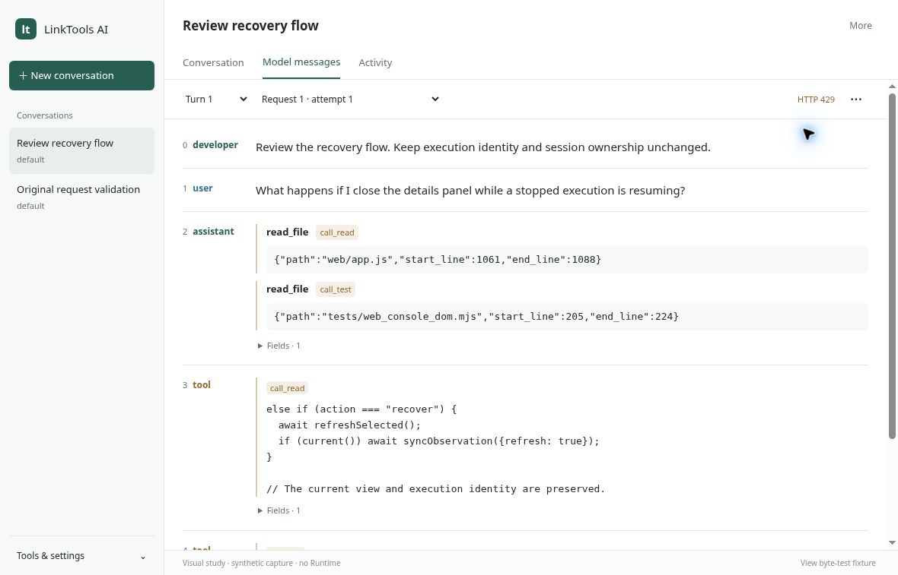
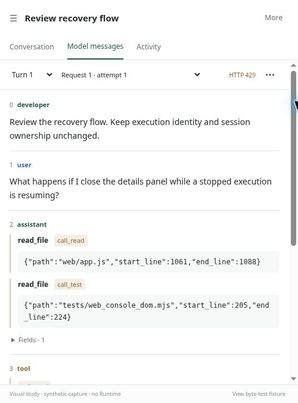

# Local Web console

The console adds a local browser interface to the same Runtime used by the AI
commands. The CLI now contains only `ai-run`, `ai-acp`, and `ai-web`; the five
inspection commands are consolidated here. Runtime still owns the execution
store, conversation history, scheduling, recovery, and metrics.

## Start

```bash
python manage.py install --editable 'linktools-ai[web]'
ai-web --project /path/to/project --model your-model
# Equivalent entry point:
python -m linktools ai web --project /path/to/project --model your-model
```

The execution stack requires Python >= 3.11, `pydantic-ai-slim>=2.66.0`
and `pydantic-ai-harness>=0.66.0`. Harness selects its matching SDK version.
After updating the checkout, rerun the install command in the same virtual environment as
`ai-web`; an existing editable install does not refresh dependency metadata
until it is installed again. `--help` only exercises lightweight CLI discovery.

Open `http://127.0.0.1:8765`. `--port` selects another local port, and `--open`
opens the URL in your browser. The existing `--base-url` and `--api-key` arguments have the same meaning
as `ai-run`; memory is supplied by the Runtime capability. Prefer environment
configuration for credentials rather than shell history. The console does not
persist or edit model credentials.

The local console uses canonical SQL conversations with native Step and Trace.
It keeps the default Agent's tools and rejects unsupported bindings before
admission rather than silently dropping tools. Skill and MCP tools require a
same-store native Step. Subagent delegation is not available on this turn path.

An embedded ordinary Runtime can enable the native read-only tools without adding
a second tool configuration. Declare the Workspace through `FileSystemCapability`
and select the tools by name on the ordinary Agent:

```python
from linktools.ai.capability import FileSystemCapability
from linktools.ai.runtime import RuntimeFeatures

features = RuntimeFeatures("workspace")
features.model("default", model_binding)
features.capability(FileSystemCapability(workspace))
features.agent(
    "review",
    allow_tools=("list_files", "read_file"),
    allow_skills=(),
    allow_subagents=(),
    allow_capabilities=(),
)
```

Pass `features` and the host's explicit session authorization policy to
`Runtime.open` with the ordinary SQL store. Send with `agent_id="review"`. Select
both tools or only the one needed; `allow_tools=("*",)` also selects unsafe
workspace tools and is not an ordinary Agent profile. The workspace policy must
allow every selected tool. Ordinary `read_file` only returns a bounded,
single-file text preview; it does not enable bulk reads, file attachments
returned by a tool, dynamically loaded skills, or shell commands. The console
shows the tool status and public preview, not raw parameters or results.

Explicit recovery of an ordinary turn regenerates from the accepted prompt,
frozen Agent binding and input attachments. It does not replay an unfinished
workspace tool result: a new authorized listing or text read sees the current
workspace, subject to the same policy and limits. Published turns and admitted
attachment bytes do not change. Use strict execution when identical prior tool
results must be continued rather than regenerated.

If recovery reports that a stopped ordinary turn cannot resume, the same
composer control can offer **End turn**. This is a separate confirmation:
it does not retry recovery or rerun tools. The Runtime releases only the
confirmed producer generation after its lease expires and preserves recorded
tool uncertainty. This control does not end Graph or split-store turns, and
turns with persisted children need a separate disposition. The child-absence
check is supported on SQLite.

Connection configuration uses the shared CLI configuration and its `LINKTOOLS_`
environment prefix. Model file-input policy uses the existing workspace file
`.linktools/config.yaml`, shared by `ai-run`, `ai-acp`, and `ai-web`:

```yaml
model: your-model
input_types:
  - image
  - document
  - mime:audio/*
  - mime:application/pdf
```

Without an override, omitting `input_types` means an empty attachment allowlist. The names `image`,
`audio`, `document`, and `video` expand to the corresponding SDK Literal sets.
Use `mime:` for explicit MIME values or `type/*` families; bare MIME strings and
`text` are not categories. Plain prompt text is unaffected.

The console's "Captured input MIME types" panel shows the expanded, normalized
`input_mime_types` list from the captured contract. It does not show the original
authoring tokens. These stored MIME permissions are not re-expanded at restore.
A match permits an input but does not verify provider support; SDK encoding and
resource limits still apply.

Use **Attach files** in the conversation composer to select local files.
Selected files are sent with the message, not read from the server workspace.
A message accepts up to 32 nonempty files, subject to the Runtime's input budget.
The Runtime uses its configured Object Store for attachment bodies;
conversation history carries attachment summaries, not file bytes.
The default attachment total is 5 MiB of original file bytes per turn. Embedded
hosts can set `RuntimeFeatures(..., limits=PromptLimits(max_turn_attachment_bytes=...))`;
a lower `max_binary_input_bytes` still applies. Web clients read the effective
limit from `/api/config`. The HTTP JSON allowance includes Base64 expansion.
Attachment bytes have a separate bound from stored text context; model input
limits and token accounting still depend on the selected provider.
The Web composer uses the default Agent.

To allow image attachments for one invocation, use `LINKTOOLS_MODEL_VISION=1 ai-web`.
The same environment variable works for `ai-run` and `ai-acp`. `LINKTOOLS_MODEL_VISION=1`
(or `true`) adds the `image` category to workspace `input_types`; `LINKTOOLS_MODEL_VISION=0`
(or `false`) removes image inputs but leaves all other types unchanged.
You can also set `LINKTOOLS_MODEL_VISION` in the `env` section of the
`.linktools.json` profile in the directory where you launch the command.
It follows the same source precedence as `LINKTOOLS_MODEL_API`. When no source
sets it, the workspace list applies as written.

The console opens one execution Runtime and requires a configured model.
Persisted history remains available in the same console. Merely opening the
console does not request a model response.

The settings panel reads current `Runtime.status()` through `/api/config` when
opened. Runtime owns the namespace, tenant, effective per-domain storage routes,
object-store identities and local paths, and metric-recorder state. These are
composition details, not a connectivity or storage health check. SQL connection
strings and provider credentials are never included. Workspace and model
configuration remain console display metadata.

A saved browser URL selects identities within the current Runtime. If a session or
execution is unavailable, the console stops its observation and disables actions
that require its loaded metadata. Refresh to retry, choose a conversation from the
current list, or explicitly create a new conversation. Missing and unauthorized
resources share the same error; it does not establish a cookie or login problem.
Check the workspace and Runtime namespace/tenant in settings if you started the
console with a different project or storage. Reading an unavailable identity never
creates it or changes authorization.

### Finding details and controls

The default **Conversation** view is the everyday workspace: conversation list,
Markdown messages and composer. New conversation asks for an Agent first; title
and working directory are under an optional disclosure. Successful turns do not
repeat technical status badges or expanded diagnostics. Failures, incomplete
responses, occupied sessions and unconfirmed cancellation remain visible.

Conversation uses one process panel per turn, with one row per root tool
call. A tool's finished state updates its existing row; the saved turn replaces
the preview in place. An unconfirmed tool outcome is not reported as success.
Conversation displays the SDK's thinking text as-is, while streaming and in
history. Successful model-request statuses and internal request numbers stay
in the diagnostic views. Provider signatures and raw tool inputs or results
remain outside Chat.

**Reuse tool progress in another host.**

Use the already-authorized `SessionTurn.process` for the history view. For a
root execution's live tool events, call
`linktools.ai.session.project_tool_process_event(event_type, payload)`.
It returns the same `ToolProcessItem` shape (or no item). Keep items keyed by
`(execution_id, item.key)`; an update replaces the same row, not a new row.
Sort positioned rows by `item.position` (turn message number, then response
part index), not by event arrival or tool call ID. Keep a known position when
a later update has no position. When the turn commits, use its saved list as
authority.
The helper does not read storage, authorize access, or interpret a transport
cursor as a tool identity. Frontends retain ownership of labels and styling.

The primary views are **Conversation**, **Model messages** and **Activity**.
Model messages opens the selected turn's actual captured input directly: indexed
role and content rows follow the native `messages` array order. A single request
and attempt selector switches among loaded captures, without nested request
cards. Turn and request selectors share one light toolbar; compact turn labels keep
their full time, status and execution identity in the control's hover/accessibility
description and the Run details picker. Older turns remain accessible and distinct
from the active conversation owner. **Request tools (···)** groups **View raw**,
**Download bytes** and **Inspect request** in one menu. The request details keep model,
purpose, timing, usage, API identity and the client-capture boundary out of the
main reading path. HTTP failures remain visible beside the selectors.

Interface titles name their content, buttons name their action, and routine status
uses one short message. Repeated technical explanations expand on demand; errors,
read-only limits and recovery confirmations remain explicit. This applies only to
console-authored text: captured messages, source bytes and tool arguments are
never rewritten or summarized.

The body is the primary surface: indexed roles align with unchanged message
content; compact function names and call IDs connect tool calls with their
separate result items visually, without moving or merging either array item.
**Fields** beside an item retains structural annotations and additional original
members. Empty, null, missing, repeated and unknown values stay inspectable;
Fields expansion and keyboard focus survive capture refresh. The observed
response remains separate from input. Repeated input arrays are never interleaved
as new conversation turns. The optional live preview is explicitly a conversation
display, not the original response bytes.

### Visual reference and implementation status

The following approved layout studies use synthetic captured-request-shaped data.
They show the current design direction, not a deployed console or a claim that
these requests reached a provider. The [DeepSeek Harness trajectory reference](https://www.deepseek.com/harness/images/feat-trace-en.webp)
informs alignment and direct role/content reading only; its session event ledger
is not substituted for this console's captured HTTP input.

Desktop: a single selection toolbar, aligned role column, body-first typography,
and contextual details rather than stacked request cards.



At 500 px, roles sit above their contents while the same selection and request
tools remain on one row. Message order and content do not change with width.



The production console implements this visual hierarchy, including the shared
selection toolbar, direct model-message reader, request tools and responsive
role layout. These images remain design studies, not production screenshots or
proof of provider receipt. [PR #167](https://github.com/linktools-toolkit/linktools/pull/167)
records the production-browser acceptance and automated verification for the
implemented assets. The layout introduces no new message protocol, renderer
owner, Runtime behavior or source reconstruction.

### Conversation, activity and diagnostics

**Activity** opens the existing recorded event timeline in the main reading
area. **More → Run details** contains selected-turn diagnostics and actions.
Their turn picker shares the same explicit execution selection. Reading modes
hide the composer; the same active Stop control remains beside the primary views.
Returning to Conversation restores the existing draft and focuses the composer.

Session occupancy comes from the active execution identity. Inspecting an older
turn never redirects active Stop to that turn. **View active execution** returns
to the owner. Details also offers **Stop active conversation** when it is
inspecting a different execution. Opening a diagnostic panel does not stop the
conversation observer. Metrics is a separate page; Executions has its own run
browser. Browser Back/Forward restores the corresponding page.

- **Run details** is centered on the selected turn: compact status, elapsed time and
  request/token usage stay visible, and the default body shows original model
  requests directly. A single **Inspect** selector replaces stacked tab bars.
  **All run metadata** keeps full execution/session fields and detailed usage;
  **Activity & tools** presents recorded events in their original order as a
  compact timeline. Select an event for its locators, usage, original record,
  SDK content drilldown and recorded child execution link. Live tree depth and
  parent execution navigation remain intact; the timeline invents no hierarchy.
  Parent/conversation links remain beside the selected identity. Closing Details
  returns focus without stopping observation or changing the selection.
- **Actions** in Details groups retry with a new prompt, fork and final JSON
  download. Stop remains directly visible for running work, including the actual
  active conversation while an older turn is selected. Failure and recovery
  states remain prominent; **Review recovery** leads directly to the same
  confirmed Resume/End and external-effect controls. **Recovery & stopped work**
  is also available from Inspect and Actions, separately from SDK debugging.
- **Inspect → Advanced SDK debugging** contains **SDK structured records**,
  **SDK text excerpts** and **SDK preparation snapshot**. These are projections,
  not final outbound messages. Instructions is labeled as a separate SDK request
  field rather than another message before a system part; original data and
  projection order are unchanged. Text excerpts contain only user/assistant text
  and omit other parts. Each debug view links to captured original requests
  instead of implying that its display order is the client message order.
- **More** groups run details, conversation rename/fork/close and recovery entry points.
  Running work has a direct **Stop** beside Send. Recovery needs and pending
  cancellation expose **Recovery options**; explicit Resume/End choices remain
  available after confirming the previous executor has stopped. They never
  infer process death or silently take ownership.
- The composer exposes **Plan mode** and a keyboard-accessible **Thinking** slider:
  Low, Medium, High, Extra high, Maximum. New drafts start at Low. The chosen
  effort is sent as `low`, `medium`, `high`, `xhigh`, or `max`; SDK/API thinking
  compatibility and provider-specific precedence remain unchanged. Ctrl / Cmd
  Enter sends. Chat messages render Markdown with a Copy action, without raw
  input or Markdown-source disclosures. Plan mode enables the SDK planning
  capability (`write_plan`); it is not a read-only mode or an authorization override.
- **Tools & settings** contains Executions, Metrics, exact-ID lookup and Runtime
  capabilities. Execution filters, explicit newest-20 scans, list paging and the
  full metric query retain their original behavior. A Conversations button
  returns from other pages. The narrow-screen sidebar closes after navigation
  and has its own close button and Escape support.
- Tool calls show Started · awaiting result as their start event arrives, and their observed result
  as it arrives, without waiting for the turn to end or opening Activity. This
  metadata is not the tool result body; incomplete observation never implies
  success. Thinking content and other ordinary activity expand on demand. Failure,
  recovery, cancellation, input-required events and observation interruptions
  remain visible. A healthy connection is not a second execution-status badge.

### Shared storage and explicit recovery

The default local SQL Runtime can open alongside another process using the same
namespace, tenant, and storage without resuming its live execution. Writable
and read-only consoles read the same committed history. Independent sessions
can run concurrently; a second execution in the same session is rejected with
`SESSION_BUSY`.

On POSIX, CLI processes of the same user in the same local workspace, PID and
network namespace can notify Web of admission, tool progress and release. A passive Web view gets key updates
through its session stream, not a second execution stream or database poll.
The authorized session read supplies the prompt and committed result; tool
notices contain display metadata only. An ACP editor still receives native
updates for its own prompt and can load committed history.

Notices are best-effort. If local IPC is unavailable, or the producer stops
after committing but before delivering the final notice, use **Refresh** to
reconnect and read the saved session. Refresh does not resume the turn.
Missed live tool updates are not replayed; the committed view is authoritative.

SQL startup does not infer that an unfinished execution is abandoned. A stopped
process can leave `PENDING_START`, `STARTED`, or `CANCELLING` visible. Refresh and
observation never take ownership. After confirming the previous executor has
stopped, use **More → End previous execution and free session** in the conversation
header to cancel the old work and release its session in one action. Standalone
executions label this action **End stopped execution**. The console requires
durable `CANCELLING` state or a successful cancellation receipt for the same
execution before finishing it through Runtime recovery. Unknown external effects
may keep `RECOVERY_REQUIRED` visible even after cancellation is recorded. The
console then verifies a terminal execution and
released session owner. It does not resume model or tool work. Unknown outcomes
are not reported as complete; another explicit attempt reads the current state
before continuing. Resolve unknown external effects in **Recovery** if needed.

To continue the original work instead, **More → Run details → Inspect → Recovery & stopped work → Resume stopped execution**
retains the explicit stopped-executor confirmation and may call models or tools.
**Stop execution** remains available for a running executor. A cancellation
request may remain `CANCELLING` until the owner finishes or the stopped-execution
action completes its cancellation. Its pending notice updates after terminal and
session-owner readback, without replacing an unrelated error. Cancellation is
shown as a normal turn outcome. Recovery uses the existing Runtime idempotency
key so a repeated request cannot start another recovery attempt; ending and
resuming work keep separate request identities.

Runtime owns producer fencing, terminal handoff, and local staging release.
The console does not introduce a private lock, heartbeat, background result
consumer, or alternative recovery implementation. See the
[Runtime history guide](runtime-history.md) for storage-specific recovery and
publication guarantees.

### Ordinary turns across processes

A host running ai-web with shared SQL storage can optionally supply a
`TurnNoticeTransport` to each process. Keep Runtime open while serving the app
and enable ASGI lifespan so the app can attach and detach the bridge:

```python
from linktools.ai.runtime import Runtime, TurnNoticeTransport
from linktools.ai.web import create_app


def build_console(runtime: Runtime, transport: TurnNoticeTransport):
    return create_app(runtime=runtime, turn_notice_transport=transport)
```

For Redis Pub/Sub, pass an open async Redis client that the host owns.
All processes sharing the same storage use the same deployment prefix;
use distinct prefixes for independent deployments. Redis DB numbers do not
isolate Pub/Sub subscriptions.

```python
from linktools.ai.runtime.redis_notices import RedisTurnNoticeTransport

transport = RedisTurnNoticeTransport(redis_client, prefix="my-deployment")
app = create_app(runtime=runtime, turn_notice_transport=transport)
```

Use the same notification backend and channel configuration for processes with
the same Runtime namespace and tenant. The host owns the transport and its
credentials. The bridge sends only admission and terminal hints after commit,
not prompt text, results or live token deltas. The receiving console reads
committed state through the existing authorized History API. A notification
does not confer access, replace SQL, or allow a receiver to recover a live turn.
A single-process host does not need to configure a transport. No database
polling or separate broker is required by the default setup.

On a reconnect or known delivery gap, the transport signals a gap even if a
browser's SSE connection stayed open. The console forwards that gap on the
existing session stream, and the browser uses the authorized session API to
fill missing committed history in pages.
A process crash after the SQL commit but before publishing a notice cannot be
detected by this bridge. If the browser stays connected without receiving a gap
or another update, use **Refresh** to read the committed state. Refresh does not
rerun the turn.

## Command consolidation and coverage

`ai-history`, `ai-session`, `ai-status`, `ai-trace`, and `ai-metrics`, including
their `lt ai` / `python -m linktools ai` forms, are intentionally removed. There
are no compatibility aliases. Start `ai-web` with the workspace model configured
to inspect persisted history, then choose Session or Execution in **Open exact ID**
to open a known identity. `ai-run` and `ai-acp` remain available for terminal execution and ACP
stdio clients. The console uses the same public Runtime domains.

The former viewers had no filter or export flags. Their optional session or
execution IDs, required trace execution ID, and optional metric name map to the
controls below. `ai-run --json` remains available, alongside final-result JSON
download in the execution inspector. Full public records can be expanded in
place; diagnostic exception messages retain their original text, including any
credentials present in the exception. Restrict access and retention accordingly.

| Command capability | Console surface | Runtime source |
| --- | --- | --- |
| `ai-run` | New conversation, composer, Plan mode/Thinking slider, live text and tool/subagent progress, Stop, final JSON download | Agent/Session `start`, Execution `watch`/`cancel`, History `result` |
| Former `ai-session` | Session list, status/revision/CWD/active execution, paged turns, create/rename/fork/close | RuntimeSessions and History session APIs |
| Former `ai-history` | Paged executions, explicit newest-by-time scan, metadata, paged SDK history/transcript, original client requests/responses, SDK prompt architecture, duration/cache usage | History `list_executions`, `scan_recent_executions`, `inspect_execution`, `history`, `transcript`, `model_interactions` |
| Former `ai-trace` | Metadata timeline with source execution, run/request/step/tool locators, duration, purpose, token usage and content drill-down | History `trace` and filtered `history` |
| Former `ai-metrics` | Twelve-metric summary, named metric, time window, dimensions/correlation filters, grouping, aggregation and buckets | Metrics `query` |
| Former `ai-status` | Runtime & capabilities: workspace/storage locations, model, captured input_mime_types allowlist, credential presence, current Agent/Tool/Skill/MCP identities | CLI composition and RuntimeFeatures source resolution |
| `ai-acp` | Equivalent explicit session create/load/continue/fork/close/cancel interactions; ACP itself remains a separate stdio transport | The same public Session and Execution APIs |

Retry, fork, recovery and external-effect resolution are explicit actions in the
execution inspector. External-effect resolution uses the Runtime's actual
operation ID and fence; the console never assumes whether an external effect
was applied. Selecting a child execution preserves its identity rather than
treating its events as a root model call. Full JSON details preserve public
fields that do not fit the compact presentation.

The **Inspect → SDK preparation snapshot** view summarizes system/fixed/dynamic instructions,
conversation context, attachment media types, tools and output contracts from
the framework request snapshot. These are SDK projections, not final native
client messages. The console never turns these instructions into a purported
original system/developer message.

### Original client sources

**Model messages** in the main view and Run details share the selected
execution's paged original records. A repeated full input array belongs to its
request; it is not presented as additional user turns. Each logical request
retains its execution/run/request identity, purpose, step, output-retry index,
usage and recorded timing. Actual HTTP attempts are ordered within that request;
no individual attempt timestamps are invented. Compaction and child executions
keep their original identities.

The current built-in capture supports OpenAI Chat completions. It records the
SDK client's final outbound body after adapter conversion and extra-body merging,
not proof of provider-server receipt. Readable rows preserve decoded string
content as plain text, including whitespace, without Markdown or HTML rendering.
Content blocks keep their array order; text blocks are readable, while media and
unknown structures retain their original source fields without loading external
resources. Standard tool calls show the captured function name/call ID and unchanged
arguments compactly; additional members remain literal under Fields, and repeated
members remain explicitly literal rather than choosing an effective value. Tool calls stay
under their assistant item; tool results keep their
own array position and call ID. Empty strings, empty arrays, null and absent
content remain distinguishable. Unknown roles remain labeled, and original
additional fields stay available in the same item’s Fields disclosure.

The reader validates JSON syntax and locates source ranges; displayed numbers
and unknown structures come from those ranges, never parsed-number reserialization.
Duplicate message fields are shown separately in source order rather than merged;
repeated member names remain literal instead of guessing an effective value.
Malformed or unrecognized envelopes show original source with an explicit limit.
**View raw** preserves the complete UTF-8 source, including escapes, large
numbers and duplicate keys. Byte downloads bypass this reading projection.
No provider array is reconstructed from SDK snapshots. The OpenAI Responses API
and other provider APIs are not claimed as captured by this binding.

The separately labeled response is the original body observed as the SDK consumed
it, with HTTP status, format/encoding hints and completeness. Received SSE data is
not reassembled into purported final assistant text. For Chat SSE, complete means
an observed complete `[DONE]` event; other bodies require observed EOF. Bytes
received in a chunk can include data the SDK did not process, while later unread
chunks are absent. Failures and cancellation can retain explicitly incomplete
output. The format is only an encoding hint, not evidence of valid JSON or success.

HTTP carries original bodies reversibly as base64. **Download original bytes**
returns those same bytes, including compressed response bytes. Supported HTTP
content encodings may also have a clearly labeled decoded-text display. That
view is derived for reading; it does not replace the original download or change
completeness. Unsupported encodings or invalid UTF-8 keep the byte download and
report that text display is unavailable. Original content is escaped text, never
HTML or parsed Markdown. **LIVE RESPONSE** remains a separate, visibly incomplete
SDK display with safe Markdown rendering.

Historical missing capture is shown as **not recorded** and is never backfilled.
An observed empty request scope, unavailable body and actual zero-byte body remain
distinct. Body content is unredacted and may include application data or secrets,
including values in `extra_body`. Capture does not read connection headers, URLs
or credential settings; this is not a guarantee that bodies contain no secrets.

List filters follow public API semantics. Execution queries support session,
agent and parent identity filters. The text search filters only loaded rows;
it is not a global full-text search. Cursor pages are passed through unchanged.
Normal execution browsing uses repository cursor order. To reproduce the former
exact newest list, select **Newest 20 (metadata scan)** under Execution order and
apply it explicitly. The current public API scans visible metadata in O(N); this
mode has no cursor or server filters and is never triggered by refresh/polling.
To inspect all executions for a session (including non-conversation children),
use its Session ID filter in Executions rather than only the conversation turns.

Read-only `History` currently exposes a recent-session list rather than a
paged session index; the UI labels this limitation. Writable mode uses the
paged RuntimeSessions API. Browsing an exact session still pages its turns. If
the Runtime reports unavailable session history, the console reads metadata
separately and shows the history error explicitly. Status, revision, working
directory and active execution remain inspectable without pretending that the
conversation is empty.

## Observation and ownership

The CLI declares one live RuntimeFeatures group, opens one
`Runtime.open(namespace, storage=..., features=features)` context, and runs one
HTTP server. Inspection uses `await runtime.features.resolve()`; it does not
freeze later registrations or Asset declarations. After the server stops,
Runtime stops its producers, closes its owned StepStore adapter and AssetStore,
then closes its owned Persistence. `create_app` accepts already-open public
Runtime/History and Metrics objects for embedding and testing; the caller owns
their lifespan.

Sending a message returns its execution ID independently of the SSE connection.
A browser disconnect closes its observer, not the execution. Stop requests
cancellation and reads the actual Runtime outcome; acceptance does not imply
that external effects or resource cleanup have finished. A concurrent Runtime
update can return a cancellation conflict. The console rereads the authoritative
status and lets you explicitly choose Stop again with the same request identity;
it never treats a conflict as success or retries cancellation automatically.
Server shutdown uses
Runtime's normal close behavior rather than creating browser-owned executions.

A writable Conversation uses one `/api/session/events?session_id=…&view=chat`
connection. The per-execution stream is for diagnostics, not Chat. The first
event reports current occupancy; later occupancy events
report changes. Local text and tool previews share this connection. A session
release does not wait for an execution observer. If its final preview frame
does not arrive, read the released turn by execution ID, not the history page.

For clients adapting the Chat protocol, positioned deltas have SSE event name
`thinking` or `text`. For example, these are the data bodies for two successive
`thinking` frames:

```json
{"execution_id":"run-id","part":"1.2.1.0","start":true}
{"execution_id":"run-id","part":"1.2.1.0","text":"first chunk"}
```

The dotted part identifies the agent run, model request, stream attempt, and
part index in that order. The first three numbers start at one; the index starts
at zero. It is scoped to an execution, not a browser connection. `start: true`
starts or replaces that part, even with no text. Otherwise append the text to
that part. A frame may both start a part and carry text. `truncated: true` means
the preview is incomplete; normal appends omit it. Preserve whitespace. On
native EventSource reconnect, the browser supplies `Last-Event-ID`; treat it as
an opaque cursor, not a part identifier. A resumed append identifies its part
without a connection-local registration table. If the Runtime has no part
coordinates, the frame omits `part`; append to the execution's text or thinking
preview for that event name. The `execution` event continues to carry tool,
attempt, reset, and terminal updates. On committed readback, replace the
preview with the authoritative turn.

Independent execution diagnostics keep the Runtime watch format and metadata-only
model projections. Model rows are replaced by
`(execution_id, agent_run_seq, model_request_seq)`; replay does not add usage a
second time, and stale RUNNING projections do not replace terminal metadata.
Cursor, authorization and integrity failures do not silently become success or
restart an execution.

SDK record/trace/prompt bodies load only for the visible selected Details tab.
Original client bodies load when the main original timeline or its inspector tab
is visible; those views share one page cache. Closing or switching views fences
pending display work. `include_client_requests=true` selects original client
bodies independently of SDK `include_content=true`, with existing execution
permissions checked before body reads. Metadata-only model reads load neither.

A completed model projection triggers an exact read using its real execution ID,
`agent_run_seq` and `model_request_seq`. Replayed completed records reuse loaded
originals; token deltas never poll or reload request bodies. Completion reads merge
without clearing earlier pages, and stale RUNNING rows cannot replace an already
loaded terminal request. Load-more and refresh failures preserve loaded content
and their retry cursor. Explicit refresh updates the loaded depth through normal
cursor pages. The durable completion notification follows the existing Runtime
commit boundary, so no extra persistence or flush timer is introduced.

Tool arguments/results and model bodies are not copied into another persistent
Web store or sent through Redis. Retained live progress can precede
committed history; the UI explicitly shows incomplete or pending content. Independently opened readers see the committed
prefix after Runtime publishes its observation batch, including RUNNING model
identities without request/response bodies. Completed requests and controlled
abnormal ends publish their available content. Refresh the same exact identity
to see newer facts. A live notification or empty page is not evidence of a
provider outcome. Publication, cross-process visibility, and recovery remain
Runtime responsibilities.

Observation follows a known execution, not the session as a whole. After that
execution finishes, an idle page needs **Refresh** to discover a new turn started
in another page. Admission still rejects concurrent work in the same session,
and cancellation targets an exact execution ID. No session-level broadcast or
automatic recovery is implied by keeping a page open.

## Local trust boundary

- The CLI binds only `127.0.0.1`; no remote-host option is provided
- The HTTP adapter requires a loopback peer and rejects explicit cross-site fetch
  metadata; mutation requests require JSON and a custom request header, with no
  permissive CORS policy
- Host and Origin headers are not restricted; the console does not provide a
  browser-origin or DNS-rebinding boundary
- Forwarded proxy headers are disabled; the actual connection peer must be
  loopback
- No persistent access token, login system or new permission model is added
- Credentials are represented only as configured/missing; exception messages
  are omitted from HTTP diagnostics because they can contain provider secrets;
  error code, safe details, exception type and cause digest remain available
- Message Markdown is rendered with raw HTML disabled; tool content stays text. Static assets
  are bundled locally, and CSP disallows external scripts, frames and plugins

An HTTP JSON request is bounded at 8 MiB, including envelope/escaping. Runtime
prompt, file, tool-result and authorization validation still applies. No browser
path bypasses Workspace policy.

### Reverse proxy

The console accepts external Host and Origin headers by default. A reverse
proxy must connect to `127.0.0.1` and provide authentication, TLS, and access
control. The console has no login: an unauthenticated public proxy exposes
history and execution, cancellation, and recovery controls. It does not trust
forwarded headers to establish the connection peer.

Cross-site fetch rejection, the mutation request header, and the absence of
permissive CORS remain in force. Serve the UI and API at the same external origin.

Keep proxy response buffering and caching disabled for both
`/api/session/events` and `/api/executions/{id}/events`, and allow long-lived responses. The
server sends `X-Accel-Buffering: no` and `Cache-Control: private, no-store,
no-transform`; a proxy must not override these directives or cache the stream.
Compression middleware that honors `no-transform`, including code-server's port
proxy, leaves these events uncompressed instead of buffering them for compression.
See the [NGINX response buffering contract](https://nginx.org/en/docs/http/ngx_http_proxy_module.html#proxy_buffering)
and [Express compression's streaming guidance](https://github.com/expressjs/compression#server-sent-events).
The Conversation continues using its session stream across turns. A dropped
diagnostic execution stream reattaches with its Runtime cursor using bounded
backoff. Neither transport failure nor proxy silence permits taking over the
executor.

## Verification

Run the repository gate with the optional Web dependencies available:

```bash
python manage.py check linktools-ai
python manage.py build linktools-ai
python manage.py verify linktools-ai
```

Session identities travel in query parameters for detail/control requests, so
opaque IDs containing slashes, Unicode, query delimiters or dot segments keep
their exact Runtime meaning.

The Web regression tests cover the cross-site-fetch and mutation-header boundaries, remote-peer rejection,
original-text diagnostics, real session/execution idempotency, history cursor
paging and content opt-in, trace/model/result/metric parity, session revision
conflicts, fork/close, read-only reopen without models, SSE cursor replay and
observer disconnect without cancellation. Cross-process HTTP tests also cover
live reads without startup takeover, explicit recovery after process exit, and
orphaned cancellation without restarting the provider. A controlled SQL revision
conflict verifies canonical readback and explicit same-identity retry without
duplicate cancellation events. A Node-backed client test checks Unicode/chunked
SSE parsing, root/child/request identity, terminal metadata
ordering and duplicate page replacement. A lightweight DOM contract harness
also exercises stale navigation/details/actions, an interrupted creation dialog,
uncertain fork identity, repeated sends and edits to the next draft. Recovery
checks cover all recoverable statuses, refresh without takeover, confirmation
rejection, repeated clicks, and terminal control reconciliation. These are
interaction-logic tests, not browser rendering tests; they skip explicitly if
Node is absent.

Browser acceptance should cover desktop/mobile layout; Unicode and hostile
HTML text; create/send/repeated submit; switching sessions/tabs during pending
requests; reload/reconnect while running; Stop; model failures; child/tool/model
detail navigation; cursor Load more; read-only empty stores; JSON export; and
closing/reopening dialogs. Use fake models and an isolated fixture store.

### Message formatting and drafts

User and assistant message text supports Markdown headings, lists, tables, links
and fenced code. The composer edits the original Markdown; the **Copy** action preserves its
exact source. Incomplete streaming code fences
are rendered safely as text/code until more content arrives. Tool structures remain available in run details; chat no longer expands raw
input payloads or Markdown source. Stored
version-1 inputs display prompt text and attachment descriptions rather than a
JSON chat bubble. No input or output storage contract is changed.

Raw HTML is escaped. Unsafe link schemes are rejected by the bundled parser;
links open with `noopener noreferrer`. Markdown images become click-only links,
and attachment descriptions do not fetch external resources. Rendering uses the
locally bundled [markdown-it 15.0.2](https://github.com/markdown-it/markdown-it)
browser ESM distribution, with HTML disabled. The original distribution and
bundled dependency license notices are retained beside the asset. Its npm tarball
integrity is `sha512-q4IGxMv56jCqT4OCRCADBoDP3LO4MhmTXjFbphHPXs4g3j9Xg5RDnxqN8IF/3vIWEU+VCnUq+7JUg/cfy2E6Qw==`.
No CDN request or browser package installation is needed. Live rendering batches
received updates and leaves historical turns unchanged between canonical reads.

Unsent prompts and planning/thinking selections are kept
per conversation in this page's memory. Switching pages or conversations does
not submit them. An admission conflict preserves the draft for an explicit next
Send; an uncertain response reuses its request identity. A confirmed admission
clears only the accepted prompt, preserving newer edits. Reloading or closing the
page clears these drafts; they are not written to browser persistent storage.
